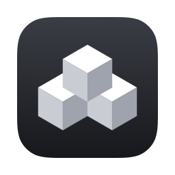
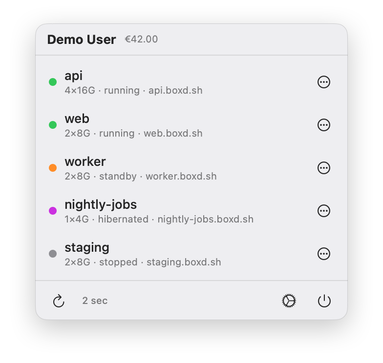

<div align="center">



# stackd

**Your boxd cloud machines, in the macOS menu bar.**

[](https://github.com/lord-helicon/stackd/actions/workflows/ci.yml)
[](LICENSE)


</div>

<p align="center">
  <picture>
    <source media="(prefers-color-scheme: dark)" srcset="docs/screenshot-dark.png">
    
  </picture>
</p>

stackd is a native menu bar app for [boxd](https://boxd.sh) cloud machines. See every machine at a glance. Start, stop, pause or wake it without opening a terminal.

It is written in SwiftUI, needs macOS 14 or later and has no dependencies.

stackd is an independent project. It is not made or endorsed by boxd.

## Install

With [Homebrew](https://brew.sh):

```bash
brew trust --formula lord-helicon/tap/stackd
brew install lord-helicon/tap/stackd
```

Homebrew only loads formulas from third-party taps after you trust them, which is what the first line does.

Homebrew builds stackd from source, so you need Xcode 26 or later (the Command Line Tools alone are not enough). The first install takes a few minutes. Then open the app:

```bash
open "$(brew --prefix stackd)/Stackd.app"
```

To keep it in your Applications folder (for Spotlight and Launch at Login), copy it there:

```bash
ditto "$(brew --prefix stackd)/Stackd.app" /Applications/Stackd.app
```

`brew upgrade` rebuilds stackd but doesn't update that copy, so run the `ditto` command again afterwards. After an upgrade, macOS asks for your Keychain password once, because a source build is signed ad hoc.

### Build from source

You need Xcode 26 or later (Swift 6).

```bash
git clone https://github.com/lord-helicon/stackd.git
cd stackd
./make-app.sh --run
```

`make-app.sh` builds a release binary and assembles `Stackd.app` next to the script. It is a menu bar app only, so there is no Dock icon. `--run` opens it when it is done. Move `Stackd.app` to `/Applications` if you want to keep it.

## Sign in

You need a boxd account and an API key.

1. Install the [boxd CLI](https://docs.boxd.sh) and sign in: `boxd auth login`
2. Create a key for stackd. The raw value is shown only once.

   ```bash
   boxd auth keys create stackd
   ```

3. Click the stackd icon in the menu bar and paste the `bxd_…` key.

API keys belong to one org. Create the key in the org that owns your machines: run `boxd auth switch <org>` first, or add `--org <org>`.

## Features

- **All your machines in the menu bar.** Name, size, status and URL, with running machines first. Click a row to open the machine's `https://<name>.<domain>` URL.
- **Actions per machine.** Use the `…` button or the right-click menu. The actions depend on the machine's state:

  | State | Actions |
  |---|---|
  | running | Stop, Reboot, Pause, Hibernate, Destroy |
  | stopped | Start, Destroy |
  | standby (paused) | Resume, Stop, Destroy |
  | hibernated | Wake, Destroy |
  | failed | Start, Destroy |

  Stop, Reboot and Destroy ask for confirmation. Destroy is irreversible and deletes the disk.
- **Live status.** Refreshes every 15 s (5, 10 or 30 s in Settings), every 3 s while a machine is starting or stopping, and right away when you open the menu. Your credits balance is in the header.
- **A menu bar mark that shows the state.** Three boxes in a pyramid, with the number of running machines next to them. It glows while connecting, shows only an outline when you are signed out, and gets a `!` badge on errors.
- **Scope.** Show your personal machines only, everything you can reach in all your orgs (the default), or one specific org.
- **Launch at login**, light and dark mode, VoiceOver labels and Reduce Motion support.

## Privacy

- Your API key lives only in your login Keychain and in memory. stackd exchanges it for a short-lived token and talks only to the boxd API (`boxd.sh` and `app.boxd.sh`).
- Keys and tokens are never logged. "Sign Out and Replace Key…" in Settings deletes the key from the Keychain.

## Troubleshooting

**macOS asks for my login password every time I rebuild.**
stackd stores your API key in the Keychain. With an ad-hoc signature, macOS sees every rebuild as a new app and asks again. Create a free **Apple Development** certificate once (Xcode → Settings → Accounts → Manage Certificates → + → Apple Development). `make-app.sh` picks it up automatically. To use a specific identity, run `SIGN_IDENTITY="…" ./make-app.sh`.

**Signing fails with `errSecInternalComponent`.**
Install Apple's [WWDR G3 intermediate certificate](https://www.apple.com/certificateauthority/AppleWWDRCAG3.cer) into your login keychain, then build again.

**I see no machines.**
API keys are tied to one org. Check that you created the key in the org that owns your machines (see [Sign in](#sign-in)), or change the scope in Settings.

## Development

```bash
swift build                                   # debug build
swift test                                    # all tests (Swift Testing)
swift test --filter MessagesTests             # one suite
./make-app.sh                                 # assemble Stackd.app
```

- **Layout** (`Sources/stackd/`): `WireFormat.swift` (minimal proto3 codec) → `Messages.swift` (API models) → `BoxdClient.swift` (grpc-web over `URLSession`, token exchange) → `AppState.swift` (state, polling, actions) → `MenuBarView.swift` (UI). `StatusMark.swift` draws the menu bar mark. `KeychainStore.swift` stores the key.
- **API trace:** `log stream --level debug --predicate 'subsystem == "li.rol.dev.stackd"'` (in zsh use `/usr/bin/log`).
- **Menu bar mark previews:** `STACKD_PREVIEW_DIR=/some/dir swift test` writes PNGs of every state.
- **README screenshot:** `STACKD_SCREENSHOT_DIR=$PWD/docs swift test --filter ScreenshotTests` renders `docs/screenshot-{dark,light}.png` from the real views with invented data.
- **App icon:** `Tools/render-icon.swift` draws the artwork. `Tools/update-icon.sh` regenerates `Resources/AppIcon.icns` and the layered `Resources/AppIcon.icon`.
- **CI:** every pull request and push to `main` builds with warnings as errors, runs the tests and assembles the app on macOS.
- **Releasing:** bump the version, merge, push a tag; see [docs/RELEASING.md](docs/RELEASING.md).

## License

[MIT](LICENSE) © 2026 Alexander Rolli
